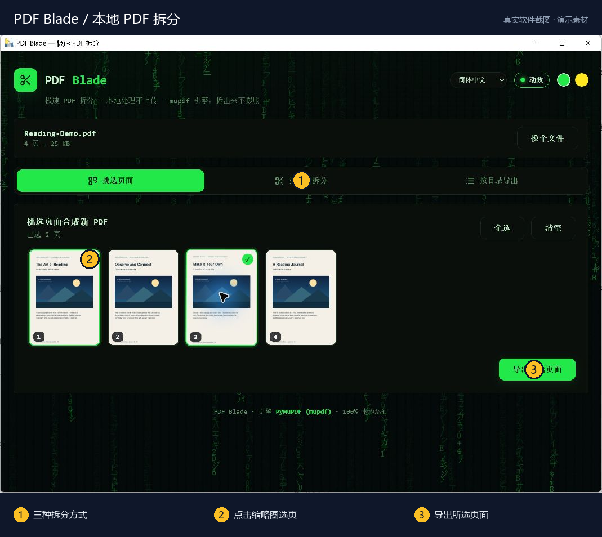
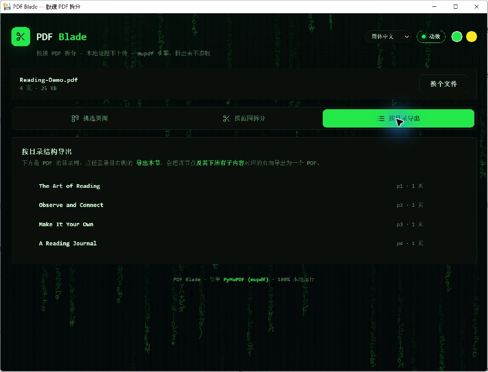

# PDF Blade

**从一整份 PDF，留下真正需要的页面。**

挑选页面 · 范围拆分 · 按目录导出。

[下载 Windows 版本](https://github.com/lyboxly-Matrix/PDF-Blade/releases) · [在线体验](https://lyboxly-matrix.github.io/PDF-Blade/) · [亮点](#项目亮点) · [快速上手](#快速上手) · [使用与开发](#使用与开发) · [反馈问题](https://github.com/lyboxly-Matrix/PDF-Blade/issues)



> 截图来自实际运行的 Windows 发布版；文档、视频和音频均为原创演示素材。编号为介绍标注。

## 项目亮点

| 亮点 | 能帮你做什么 |
| --- | --- |
| **三种拆分方式** | 手选页面、输入页码范围，或沿内嵌书签按章节导出。 |
| **打开浏览器即可体验** | 网页版无需登录，PDF 内容只在浏览器本地处理。 |
| **桌面版适合本地工作流** | 提供 Windows EXE；导出时清理未使用对象并压缩，尽量控制文件体积。 |

## 跟着界面认识功能

### ① 看缩略图，勾选要保留的页面

上图为 Windows 桌面版真实截图，已选中演示 PDF 的 **第 1、3 页**。点击缩略图切换选中状态，右下角「导出所选页面」把选中的页面合成新 PDF。

### ② 沿目录拆章节



切换到「按目录导出」，界面列出 PDF 内嵌书签、起始页码和章节页数。将鼠标移到章节条目上，从右侧「导出本节」操作，可将该章节及其子章节对应页面导出。

### ③ 有明确页码时，直接按范围拆分

中间的「按范围拆分」适合已知页码的任务，例如输入 `1-2, 4`。网页版与桌面版都提供选页、范围和目录三种入口；处理 PDF 内容无需上传文件。

## 快速上手

[打开网页版](https://lyboxly-matrix.github.io/PDF-Blade/) → 拖入 PDF → 选择页面、范围或目录章节 → 导出。

Windows 用户也可在 Releases 下载 `PDF-Blade-windows-x64.exe`，直接运行。

## 使用与开发

一款专精 PDF 拆分、完全本地运行的网页与 Windows 工具。

网页版使用 pdf.js 与 pdf-lib，文件始终留在浏览器中；桌面版使用 PyMuPDF 与 pywebview，导出时会清理未使用的 PDF 对象并进行压缩，尽量避免拆分后的文件体积膨胀。

## 功能

- 挑选任意页面，合成为新的 PDF
- 按页码范围批量拆分，例如 `1-3, 5, 8-10`
- 按 PDF 内嵌目录（书签）导出章节及其子章节
- 页面缩略图懒加载
- 简体中文、English、Español、Português、Français、Deutsch、Русский、日本語、한국어、العربية
- 多主题与可关闭的动态效果
- 100% 本地处理，无需上传文件

## 在线使用

访问 [PDF Blade 网页版](https://lyboxly-matrix.github.io/PDF-Blade/)，拖入 PDF 即可开始。

网页版无需登录，支持挑选页面、按页码范围拆分，以及沿 PDF 内嵌目录导出章节。所有 PDF 内容都只在浏览器内存中处理。

## 下载和使用

前往仓库的 **Releases** 页面，下载 `PDF-Blade-windows-x64.exe`，然后直接运行。

当前 Windows 构建未进行代码签名。首次运行时，Windows SmartScreen 可能显示安全提示。请只从本仓库的 Releases 页面下载。

## 从源码运行

需要 Python 3.11。

```powershell
python -m venv .venv
.venv\Scripts\Activate.ps1
python -m pip install --upgrade pip
python -m pip install -r requirements.txt
python app.py
```

## 构建 Windows 可执行文件

```powershell
python -m pip install -r requirements-dev.txt
pyinstaller --noconfirm "PDF Blade.spec"
```

构建结果位于 `dist\PDF Blade.exe`。

## 技术结构

- `app.py`：桌面入口、pywebview API 和 PyMuPDF 处理逻辑
- `ui.html`：正式桌面界面
- `PDF Blade.spec`：PyInstaller 单文件构建配置
- `index.html`：正式网页版，使用 pdf.js、pdf-lib 与 JSZip 在浏览器本地处理
- `.github/workflows/pages.yml`：自动发布网页版到 GitHub Pages

核心导出流程会创建新的 PDF，插入所需页面，并使用 `garbage=4`、`deflate=True` 和 `clean=True` 保存。

## 发布新版本

推送形如 `v1.0.0` 的 Git 标签后，GitHub Actions 会在 Windows 构建机上生成可执行文件，并自动创建对应的 GitHub Release。

```powershell
git tag v1.0.0
git push origin v1.0.0
```

## 隐私

桌面版没有上传接口，也不需要网络连接。PDF 内容只在本机由 PyMuPDF 读取和处理。

## 许可证

本项目采用 [MIT License](LICENSE)。

